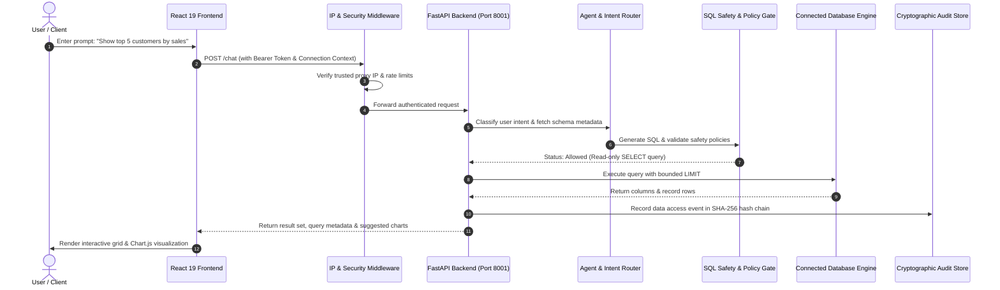
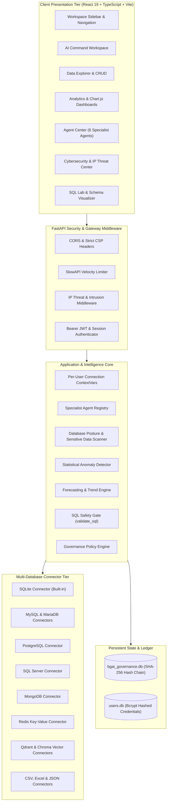

# BG AI — AI-Powered Conversational Database Intelligence & Visualization

[](https://fastapi.tiangolo.com)
[](https://react.dev)
[](https://vitejs.dev)
[](https://tailwindcss.com)
[](https://www.sqlalchemy.org)
[](https://www.python.org)

**BG AI** is a production-oriented, AI-powered conversational database intelligence workspace. It bridges natural-language user queries with multi-engine database management, visual analytics, autonomous specialist agents, automated anomaly detection, forecasting, and enterprise-grade cybersecurity governance.

- **Web Application:** [https://thebg.co.in/](https://thebg.co.in/)
- **Backend API Deployment:** [https://bg-chatbox.onrender.com](https://bg-chatbox.onrender.com)
- **Interactive Swagger Documentation:** [https://bg-chatbox.onrender.com/docs](https://bg-chatbox.onrender.com/docs)

---

## Table of Contents

- [1. Problem Statement](#1-problem-statement)
- [2. Our Solution](#2-our-solution)
- [3. Key Features](#3-key-features)
- [4. How BG AI Works](#4-how-bg-ai-works)
- [5. System Architecture](#5-system-architecture)
- [6. Technology Stack](#6-technology-stack)
- [7. Supported Databases & Connectors](#7-supported-databases--connectors)
- [8. Project Directory Structure](#8-project-directory-structure)
- [9. Prerequisites](#9-prerequisites)
- [10. Installation & Local Setup](#10-installation--local-setup)
- [11. Environment Variables](#11-environment-variables)
- [12. Running BG AI Locally](#12-running-bg-ai-locally)
- [13. Core API Endpoints](#13-core-api-endpoints)
- [14. Database Connection & Lifecycle](#14-database-connection--lifecycle)
- [15. Security, Governance & Intrusion Safeguards](#15-security-governance--intrusion-safeguards)
- [16. Testing & Quality Assurance](#16-testing--quality-assurance)
- [17. Deployment Architecture](#17-deployment-architecture)
- [18. Troubleshooting Guide](#18-troubleshooting-guide)
- [19. Product Roadmap](#19-product-roadmap)
- [20. Contributing](#20-contributing)
- [21. License](#21-license)
- [22. Acknowledgements & Authors](#22-acknowledgements--authors)

---

## 1. Problem Statement

Modern enterprise data architectures face severe accessibility and governance bottlenecks:

1. **SQL Skill Barriers:** Business teams and analysts frequently depend on data engineers to write complex SQL joins, aggregations, or document queries.
2. **Context Switching Across Data Engines:** Teams juggle different management interfaces for relational databases (MySQL, PostgreSQL, SQLite, SQL Server), NoSQL document databases (MongoDB), in-memory caches (Redis), vector databases (Qdrant, Chroma), and flat files (CSV, Excel).
3. **Operational Risks of Destructive Queries:** Conversational AI assistants that execute arbitrary SQL risk accidental data loss from unchecked `DROP`, `TRUNCATE`, or unconstrained `UPDATE`/`DELETE` queries.
4. **Data Privacy & Credential Leakage:** Many LLM-assisted database tools unwittingly transmit unmasked Personally Identifiable Information (PII), credit card numbers, or database connection strings containing plaintext passwords to external cloud models.
5. **Lack of Verifiable Auditability:** Typical AI operations lack cryptographic proof of provenance, tamper resistance, and intrusion tracking.

---

## 2. Our Solution

BG AI eliminates these challenges through a unified, secure database intelligence platform:

- **Conversational Intelligence:** Converts plain English into safe, validated SQL queries and document aggregations.
- **Multi-Engine Connector Architecture:** Seamlessly connects to SQLite, MySQL, PostgreSQL, MariaDB, SQL Server, MongoDB, Redis, Qdrant, Chroma, and tabular flat files.
- **Deterministic Security Gates:** Enforces human-in-the-loop confirmation for write mutations, unconditionally blocks destructive DDL (`DROP`, `TRUNCATE`, `ALTER`), and validates `WHERE` clauses.
- **Autonomous Specialist AI Agents:** Dispatches tasks across 6 specialized agents for data quality, health assessment, anomaly detection, business intelligence, query performance, and controlled mutations.
- **Enterprise Governance & Tamper-Evident Ledger:** Implements a SHA-256 hash-chained immutable audit ledger, client IP intrusion detection, brute-force defense, and a zero-raw-secret sensitive data exposure scanner.

---

## 3. Key Features

### 💬 AI Command Workspace
- Natural-language query translation into safe SQL or native connector operations.
- Dynamic result tables with column sorting, live search filtering, pagination, and export to CSV, Excel, or PDF.
- Context-aware introductory summaries and query suggestions generated from the live database schema.

### 📊 Visual Analytics & Auto-Generated Charts
- Instant generation of interactive Chart.js visualizations (bar, line, doughnut, pie, polar area).
- Interactive Mermaid.js database relationship graphs and entity-relationship (ER) diagrams with foreign-key inspection.

### 🗄️ Multi-Database Data Explorer & CRUD
- Live database schema inspection for tables, columns, data types, indexes, and constraints.
- Inline record creation, cell-level editing, record deletion, and dynamic index management.
- Dynamic table creation and schema definitions across relational and NoSQL engines.

### 🧪 SQL Lab
- Raw SQL query editor with syntax highlighting, execution timing telemetry, row count reporting, and safe query validation.

### 🤖 Autonomous Specialist Agents (Phase 5)
- **Database Health Agent:** Evaluates connection health, schema complexity, missing indexes, and engine metrics.
- **Data Quality Agent:** Inspects null ratios, duplicates, invalid formats, and data anomalies.
- **Analyst Agent:** Performs cohort calculations, growth trends, top-contributor breakdowns, and revenue analytics.
- **Anomaly Agent:** Identifies structural anomalies, out-of-range numerical spikes, and orphaned records.
- **Performance Agent:** Pinpoints slow query bottlenecks, unindexed foreign keys, and missing secondary indexes.
- **Action Agent:** Prepares structured mutation plans (`INSERT`, `UPDATE`, `DELETE`) with bounded row estimation (`COUNT(*)`) and mandatory human confirmation.

### 🔍 Proactive Intelligence & Forecasting
- Evaluates operational KPIs, data velocity, completeness, and freshness.
- Statistical forecasting view tracking historical metric series and projected confidence bands.
- Centralized Anomaly Center reporting categorized severity levels (Critical, Warning, Informational).

### 🛡️ Cybersecurity & Intrusion Center
- **Security Posture Score (0–100):** Real-time posture assessment with mathematical deductions for vulnerabilities.
- **Sensitive Data Exposure Scanner:** Conservative regex and Luhn-validated detection of credit card numbers, plain passwords, SSNs, and private API keys with zero raw secret exposure.
- **IP Threat Intelligence & Intrusion Detection:**
  - Trusted-proxy IP extraction preventing spoofed `X-Forwarded-For` injection.
  - Brute-force authentication detection ($\ge 5$ failures within 300s).
  - High-frequency burst detection ($\ge 60$ requests within 60s).
  - Scanner/crawler probe identification (probing `.env`, `wp-`, `actuator`, `shell`).
  - Automated, time-limited IP quarantine with manual administrative unblock controls.
- **Tamper-Evident Audit Ledger:** Cryptographic SHA-256 hash-chained operational ledger with real-time verification.
- **Guardrail Policy Controls:** Human confirmation modals required before modifying live security guardrails.

---

## 4. How BG AI Works



---

## 5. System Architecture



---

## 6. Technology Stack

### Frontend
- **Framework:** React 19.2, TypeScript 6.0
- **Bundler & Build Tool:** Vite 8.2
- **Styling:** Tailwind CSS v4, Lucide React Icons
- **Data Visualizations:** Chart.js 4.5, React-ChartJS-2, Mermaid.js 11.16
- **Workflow & Diagrams:** @xyflow/react 12.11
- **Exporting & Reporting:** jsPDF, html2canvas, SheetJS (xlsx), FileSaver

### Backend
- **Web Framework:** FastAPI 0.141, Starlette, Uvicorn 0.52
- **ORM & Database Driver:** SQLAlchemy 2.0, PyMySQL 1.1, psycopg2-binary
- **Authentication & Security:** Python-JOSE, Passlib / Bcrypt 5.0, SlowAPI
- **LLM & Inference:** Groq Python SDK (`llama-3.3-70b-versatile`, `openai/gpt-oss-20b`)
- **Data & Configuration:** Pydantic v2, Python-Dotenv, Python-Multipart

---

## 7. Supported Databases & Connectors

| Database Engine | Category | Status | Capabilities Supported |
| :--- | :--- | :---: | :--- |
| **SQLite** | Relational | **Fully Implemented** | Read, Write, Schema Inspection, Record CRUD, Index Management, Table Creation |
| **MySQL** | Relational | **Fully Implemented** | Read, Write, Schema Reflection, Dynamic Records, Index DDL, TLS Checks, Privileges |
| **PostgreSQL** | Relational | **Fully Implemented** | Read, Write, Schema Metadata, Relational CRUD, Index Operations, SSL Verification |
| **MariaDB** | Relational | **Fully Implemented** | Drop-in MySQL protocol support, CRUD, Schema Reflection |
| **SQL Server (MSSQL)** | Relational | **Fully Implemented** | PyODBC / SQLAlchemy MSSQL connector, Schema Metadata, Bounded Queries |
| **MongoDB** | Document | **Fully Implemented** | PyMongo connector, Collection Browsing, Document CRUD, Document Count Summaries |
| **Redis** | Key-Value | **Fully Implemented** | In-memory key listing, Key-value CRUD, TTL telemetry, Hash inspection |
| **Qdrant** | Vector AI | **Fully Implemented** | Collection listing, Vector payload inspection, Dimension metadata |
| **Chroma DB** | Vector AI | **Fully Implemented** | Collection discovery, Embedding counts, Metadata retrieval |
| **CSV / Excel / JSON** | Flat Files | **Fully Implemented** | Upload to in-memory/file SQL table, Dynamic SQL querying, Export |

---

## 8. Project Directory Structure

```text
BG_AI/
├── backend/
│   ├── app/
│   │   ├── agent/                 # Conversational orchestrator & Groq LLM client
│   │   ├── agents/                # Autonomous specialist agents & Action Agent
│   │   ├── connectors/            # Multi-database connector registry & implementations
│   │   │   ├── base.py            # BaseConnector abstract interface
│   │   │   ├── relational.py      # SQLite, MySQL, Postgres, MSSQL, MariaDB
│   │   │   ├── mongodb.py         # MongoDB document connector
│   │   │   ├── redis_connector.py # Redis key-value connector
│   │   │   ├── vector.py          # Qdrant & Chroma vector connectors
│   │   │   ├── file_connectors.py # CSV, Excel, JSON connectors
│   │   │   └── registry.py        # Centralized ConnectionRegistry
│   │   ├── crud/                  # Dynamic CRUD service & Intent detection
│   │   ├── database/              # ContextVars engine isolation & backup services
│   │   ├── intelligence/          # Analytics, anomaly detection, forecasting, governance
│   │   │   └── governance/        # Tamper-evident hash chain & audit store
│   │   ├── security/              # Auth, posture scanner & IP intrusion intelligence
│   │   │   ├── auth.py            # JWT token encoding & decoding
│   │   │   ├── sessions.py        # User authentication & password hashing
│   │   │   ├── posture_scanner.py # Sensitive data scanner & posture score engine
│   │   │   └── ip_intelligence.py # IP threat detection & temporary quarantine
│   │   ├── tools/                 # SQL validation, schema extraction, chart generation
│   │   ├── main.py                # FastAPI route registration & middleware
│   │   └── config.py              # Environment configuration & Groq model bindings
│   ├── requirements.txt           # Python backend dependencies
│   └── scratch/                   # Automated unit & integration verification test suites
├── frontend/
│   ├── src/
│   │   ├── components/
│   │   │   ├── chat/              # AI Command conversation interface & modals
│   │   │   ├── ui/                # UI widgets & BG AI ModelSelector
│   │   │   └── workspace/         # Main workspace layout, headers, views
│   │   │       └── views/         # 11 Dedicated functional views
│   │   ├── services/
│   │   │   └── api.ts             # Typed REST API client methods
│   │   ├── types/
│   │   │   └── index.ts           # Shared TypeScript interfaces & types
│   │   ├── pages/
│   │   │   └── Home.tsx           # Primary workspace application container
│   │   └── main.tsx               # React application entrypoint
│   ├── package.json               # Frontend dependencies & build scripts
│   ├── vite.config.ts             # Vite build & proxy configuration
│   └── tailwind.config.js         # Tailwind CSS styling configuration
└── README.md                      # Complete system documentation
```

---

## 9. Prerequisites

Before setting up BG AI locally, ensure the following software is installed:

- **Python:** Version `3.11` or higher
- **Node.js:** Version `18.0.0` or higher (Node 20+ recommended)
- **Package Manager:** `npm` (bundled with Node.js)
- **Operating System:** Windows 10/11, macOS, or Linux
- **Git:** Version `2.30` or higher
- **Groq API Key:** Required for natural-language SQL generation and AI agent reasoning (free tier available at [groq.com](https://console.groq.com/)).

---

## 10. Installation & Local Setup

### Step 1: Clone the Repository

Open Windows PowerShell or your terminal and clone the repository:

```powershell
git clone https://github.com/boopathiravi03/BG_chatbox.git
cd BG_chatbox
```

### Step 2: Configure the Backend Environment

Navigate to the `backend` directory and create a virtual environment:

```powershell
cd backend
python -m venv venv
.\venv\Scripts\Activate.ps1
```

Install backend dependencies:

```powershell
pip install -r requirements.txt
```

Create a `.env` file in `backend/.env`:

```ini
# Groq Inference Credentials
GROQ_API_KEY=your_groq_api_key_here
GROQ_MODEL=llama-3.3-70b-versatile

# JWT Authentication Secret
JWT_SECRET_KEY=generate_a_secure_random_secret_key_here
JWT_ALGORITHM=HS256
ACCESS_TOKEN_EXPIRE_MINUTES=1440

# Optional Reverse Proxy & Intrusion Settings
BGAI_TRUSTED_PROXIES=127.0.0.1,10.0.0.0/8
BGAI_TEMP_BLOCK_DURATION=900
```

### Step 3: Configure the Frontend Environment

Open a separate terminal window, navigate to the `frontend` directory, and install packages:

```powershell
cd frontend
npm install
```

Create a `.env` file in `frontend/.env`:

```ini
# Base URL for the FastAPI Backend
VITE_API_BASE=http://localhost:8001
```

---

## 11. Environment Variables

| Variable Name | Required | Default Value | Description |
| :--- | :---: | :--- | :--- |
| `GROQ_API_KEY` | **Yes** | *None* | Authentication token for Groq LLM inference |
| `GROQ_MODEL` | No | `llama-3.3-70b-versatile` | LLM model identifier for SQL translation |
| `JWT_SECRET_KEY` | **Yes** | *None* | Cryptographic salt used for signing access JWT tokens |
| `JWT_ALGORITHM` | No | `HS256` | Token signing algorithm |
| `BGAI_EXTRA_ORIGINS` | No | `http://localhost:5173,...` | Comma-separated CORS allowed origin URLs |
| `BGAI_TRUSTED_PROXIES` | No | *Empty (Untrusted)* | Whitelisted reverse-proxy IP addresses or CIDRs |
| `BGAI_AUTH_FAILURE_THRESHOLD`| No | `5` | Failed logins before brute-force alert is raised |
| `BGAI_TEMP_BLOCK_DURATION` | No | `900` | Duration (seconds) of automated IP quarantine blocks |
| `VITE_API_BASE` | No | `http://localhost:8001` | Frontend target URL for backend API requests |

---

## 12. Running BG AI Locally

### 1. Launch the Backend Server

From the `backend` directory with the virtual environment activated:

```powershell
uvicorn app.main:app --host 127.0.0.1 --port 8001 --reload
```

- **Backend Address:** `http://127.0.0.1:8001`
- **Swagger Documentation:** `http://127.0.0.1:8001/docs`
- **ReDoc Documentation:** `http://127.0.0.1:8001/redoc`

### 2. Launch the Frontend Development Server

From the `frontend` directory:

```powershell
npm run dev
```

- **Frontend Address:** `http://localhost:5173`

Open your browser to `http://localhost:5173`, create a user account via the registration modal, and connect your database or use the built-in SQLite sample database.

---

## 13. Core API Endpoints

### 🔐 Authentication (`/auth`)
- `POST /auth/register` — Register a new account with bcrypt password hashing.
- `POST /auth/login` — Authenticate credentials and receive Bearer JWT.
- `GET /auth/me` — Retrieve verified profile of current authenticated user.

### 💬 Conversational Intelligence & SQL (`/`)
- `POST /chat` — Translate natural language into executed query results with schema suggestions.
- `POST /query` — Execute validated SQL query on active user connection.
- `POST /confirm-query` — Confirm execution of pending data mutations (`INSERT`/`UPDATE`/`DELETE`).
- `GET /schema` — Retrieve complete schema metadata (tables, columns, types).
- `GET /dashboard` — Retrieve live table counts, row counts, and summary statistics.

### 🔌 Multi-Database Connections (`/connections`)
- `GET /connections/catalog` — List supported database connector catalog.
- `GET /connections` — List all registered connectors for active user.
- `POST /connections` — Register and connect a new database source.
- `POST /connections/switch` — Switch active workspace database connection.
- `DELETE /connections/{connection_id}` — Safely disconnect and remove database connection.

### 🤖 Autonomous Agents (`/agents`)
- `GET /agents` — List available specialist AI agents.
- `POST /agents/run` — Run an autonomous task through intent-routed specialist agent.
- `GET /agent-actions` — List proposed mutation plans requiring confirmation.
- `POST /agent-actions/{action_id}/confirm` — Execute confirmed mutation plan within database transaction.
- `POST /agent-actions/{action_id}/cancel` — Cancel proposed mutation plan.

### 🛡️ Cybersecurity & IP Threat Center (`/security`)
- `POST /security/scan` — Run bounded, read-only cybersecurity posture scan on active connection.
- `POST /security/explain` — Generate AI advisory explaining vulnerability risks with zero raw secret leaks.
- `GET /security/ip-threats` — List recorded intrusion events, brute-force detections, and active blocks.
- `POST /security/ip-threats/reputation` — Query behavioral IP reputation profile.
- `POST /security/ip-threats/unblock` — Administratively lift an active temporary IP quarantine.

### 📜 Enterprise Governance & Audit (`/intelligence/governance`)
- `GET /intelligence/governance/audit` — Retrieve immutable audit ledger entries.
- `POST /intelligence/governance/audit/verify` — Cryptographically verify SHA-256 hash chain integrity.
- `GET /intelligence/governance/policies` — List operational guardrail policies.
- `POST /intelligence/governance/policies/status` — Enable or disable configurable guardrails.

---

## 14. Database Connection & Lifecycle

BG AI supports connecting to existing databases via the **Data Sources** or **Database Modal**:

1. **Local & File Databases:** Upload a `.sqlite`, `.db`, `.csv`, `.xlsx`, or `.json` file. The backend reads schema metadata dynamically without copying external credentials.
2. **Network Databases (MySQL, PostgreSQL, MSSQL, MongoDB, Redis):** Provide connection credentials (host, port, database name, username, password).
3. **Password Masking:** Connection credentials are sanitized immediately upon registration. Raw passwords and secrets are **never returned by the API** (`hide_password=True`) and are omitted from serialized state.
4. **Context Isolation:** Active connections are isolated per user via Python `ContextVar`, preventing cross-tenant bleed or concurrent query collisions.

---

## 15. Security, Governance & Intrusion Safeguards

BG AI employs defense-in-depth security controls:

- **Strict SQL Safety Gate (`validate_sql`):**
  - Unconditionally blocks destructive DDL (`DROP TABLE`, `TRUNCATE TABLE`, `ALTER TABLE`).
  - Prohibits stacked multi-statement injection attacks (`;`).
  - Enforces mandatory `WHERE` clause presence on `UPDATE` and `DELETE` queries.
  - Requires human confirmation before applying single-table mutations.
- **Trusted-Proxy Header Verification:** Client IP extraction verifies `X-Forwarded-For` and `X-Real-IP` only when the direct peer socket matches an entry in `BGAI_TRUSTED_PROXIES`.
- **Intrusion Detection:**
  - Automated detection of brute-force authentication attacks and path crawlers.
  - Temporary quarantine blocks with automatic expiration and administrative unblock overrides.
- **Sensitive Data Redaction:** Bounded posture scanning (`MAX_SAMPLE_ROWS = 50`, `MAX_TABLES_TO_SCAN = 15`) uses conservative regular expressions and Luhn checksum validation to detect unmasked payment cards, plain passwords, and tokens without logging or storing raw sensitive data.
- **Tamper-Evident SHA-256 Audit Chain:** Every governance and security action generates a cryptographic link `Hash(Event + PrevHash)`, verifying log immutability on demand.

---

## 16. Testing & Quality Assurance

All features in BG AI are verified by automated backend test suites and strict frontend TypeScript builds.

### Run Verification Test Suites (PowerShell)

Activate the backend virtual environment and execute the test scripts:

```powershell
cd backend

# 1. IP Threat Intelligence & Intrusion Detection (11/11 PASS)
python scratch/test_ip_intelligence.py

# 2. Database Cybersecurity & Sensitive Data Scanner (13/13 PASS)
python scratch/test_cybersecurity_phase1.py

# 3. Autonomous Specialist Agents & Routing (32/32 PASS)
python scratch/test_phase5_agents.py

# 4. Overview & Database Statistics Synchronization (3/3 PASS)
python scratch/test_overview_sync_stats.py

# 5. Anomaly Center & Metric Evaluator Synchronization (3/3 PASS)
python scratch/test_anomaly_overview_sync.py

# 6. Database Read/Write & Connector Capabilities (14/14 PASS)
python scratch/test_read_write_capabilities.py
```

### Run Frontend Production Build

From the `frontend` directory, verify TypeScript compilation and bundle generation:

```powershell
cd frontend
npm run build
```

*Expected output: Clean production build with 0 TypeScript errors.*

---

## 17. Deployment Architecture

BG AI is structured for cloud deployment across separate frontend and backend tiers:

- **Frontend Deployment (Client Tier):** Static single-page application built with Vite and hosted on CDN infrastructure serving [https://thebg.co.in/](https://thebg.co.in/).
- **Backend Deployment (API Tier):** Python FastAPI application hosted on Render at [https://bg-chatbox.onrender.com](https://bg-chatbox.onrender.com).
- **CORS & CSP Configuration:** Backend explicitly permits requests from `https://thebg.co.in` and local development origins with strict Content-Security-Policy headers.

---

## 18. Troubleshooting Guide

| Issue | Root Cause | Solution |
| :--- | :--- | :--- |
| `HTTP 401 Unauthorized` | Missing or expired JWT access token | Log in via the account modal or submit credentials to `POST /auth/login`. |
| `HTTP 403 Forbidden: Access Denied` | Source IP is under temporary quarantine | Review active blocks in Cybersecurity -> IP Threats, or call `POST /security/ip-threats/unblock`. |
| `Connection refused: localhost:8001` | Backend FastAPI server is not running | Start backend with `uvicorn app.main:app --port 8001 --reload` in `backend/`. |
| `PyMySQL / psycopg2 missing` | Database drivers not installed in virtualenv | Run `pip install -r requirements.txt` inside the activated virtual environment. |
| `Groq API Key Error / Invalid Key` | `GROQ_API_KEY` missing in `.env` | Set a valid `GROQ_API_KEY` in `backend/.env`. |
| `Vite build fails on TypeScript` | Outdated dependencies or missing node modules | Run `npm install` followed by `npm run build` in `frontend/`. |

---

## 19. Product Roadmap

The following capabilities are actively planned for future releases:

- [ ] **Multi-Region Audit Ledger Replication:** Cross-region consensus replication for tamper-evident audit logs.
- [ ] **Asynchronous Background Task Workers:** Celery / Redis queue worker for large-scale enterprise database profiling.
- [ ] **Custom Enterprise SSO Providers:** SAML 2.0 and OIDC integrations for enterprise identity providers.
- [ ] **Role-Based Fine-Grained Permissions (RBAC):** Column-level and row-level masking policies per user role.

---

## 20. Contributing

Contributions to BG AI are welcome. To contribute:

1. **Fork the Repository:** Create your own branch (`git checkout -b feature/your-feature-name`).
2. **Follow Coding Standards:** Adhere to PEP 8 standards for Python and ESLint/TypeScript guidelines for the frontend.
3. **Execute Test Suites:** Ensure all tests pass (`python scratch/test_ip_intelligence.py`, `npm run build`).
4. **Submit a Pull Request:** Provide a clear description of the fix or feature.

---

## 21. License

This repository does not currently specify an open-source license. All rights are reserved by the original project authors. For permissions or licensing inquiries, please contact the maintainers.

---

## 22. Acknowledgements & Authors

- **Developed By:** [Boopathi Ravi](https://github.com/boopathiravi03)
- **Project Repository:** [boopathiravi03/BG_chatbox](https://github.com/boopathiravi03/BG_chatbox)
- **Official Website:** [https://thebg.co.in/](https://thebg.co.in/)
